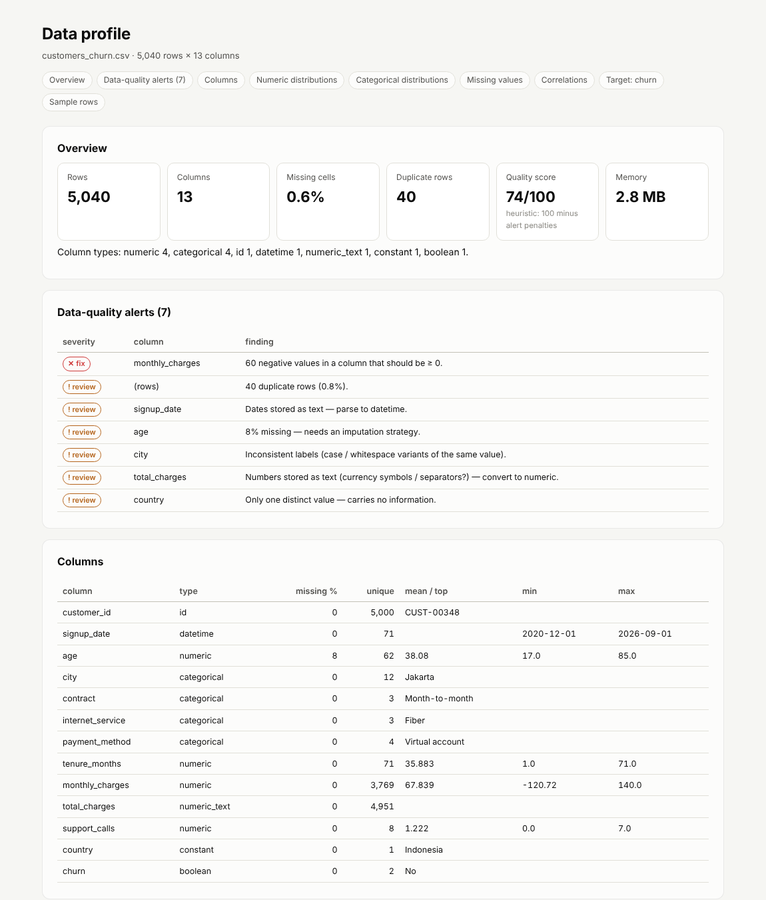
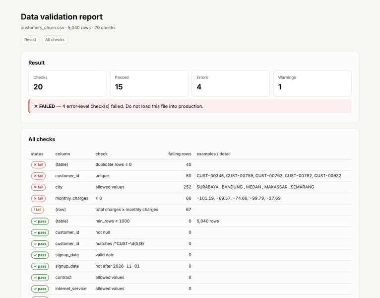
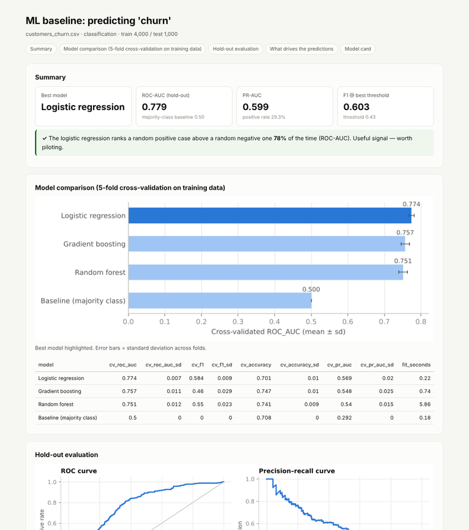
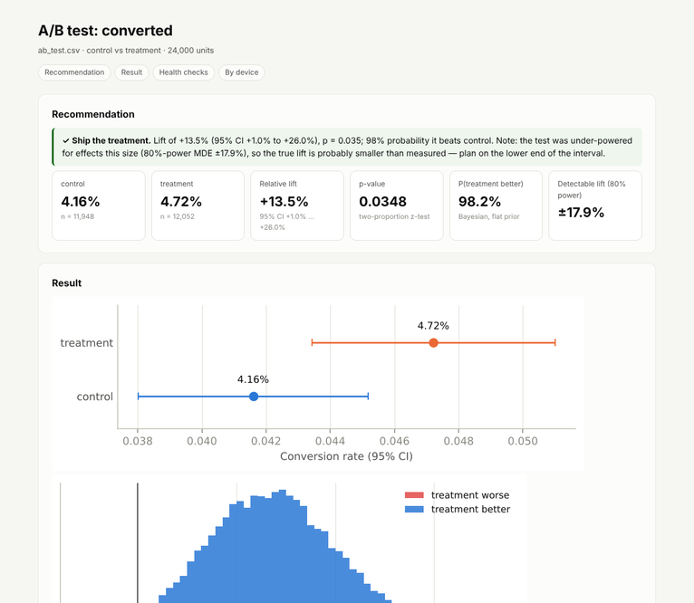
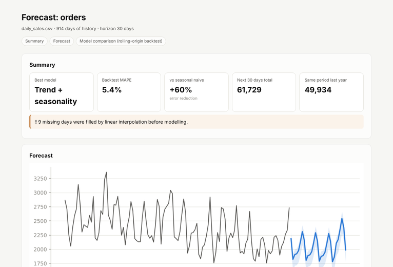
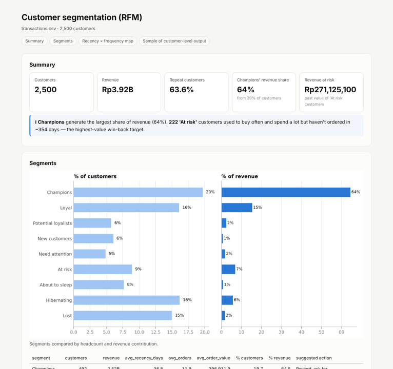
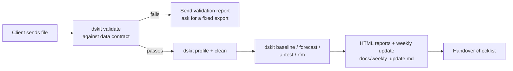

# A Practical Data Science Workflow & Reporting Toolkit
dskit — a data science toolkit for client & remote work

> One command turns a raw client file into a report the client can read.
> Profile → validate → clean → model → forecast → A/B test → segment,
> each producing a single self-contained HTML file you can email, attach to a
> ticket or host on GitHub Pages.

    

**Example reports:** [`examples/reports/`](examples/reports) · live gallery: _GitHub Pages link after the first CI run_

```bash
pip install git+https://github.com/YOUR_USERNAME/ds-toolkit.git
dskit profile customers.csv --target churn          # → reports/customers_profile.html
```

---

## Why

Most freelance and remote data-science work starts the same way: a messy CSV
or Excel export, a vague question, and a client who needs to *see* progress.
The first days go to the same chores — checking the data, cleaning it, a quick
baseline, writing it up. `dskit` does those chores in minutes, with sensible
statistics and honest validation, so the time goes into the actual problem.

## Commands

| Command | What you get | Typical client question |
|---|---|---|
| `dskit profile` | EDA + data-quality alerts (missing, duplicates, numbers-as-text, inconsistent labels, outliers, leakage) with a quality score | "Is our data usable?" |
| `dskit validate` | Pass/fail check against a YAML **data contract**; exit code 1 on failure (CI-ready). `--suggest` drafts the contract for you | "Tell us when a monthly export is broken" |
| `dskit clean` | Auditable cleaning: snake_case columns, trim, `Rp 1.234,50` → 1234.5, dates, booleans, label unification, dedupe — every change logged | "Can you fix this export?" |
| `dskit baseline` | Auto-detects classification/regression; 4 models × 5-fold CV, hold-out test, ROC/PR or residual plots, threshold table, permutation importance, **model card** | "Can we predict churn / price / demand?" |
| `dskit predict` | Scores a new file with a saved baseline model | "Score this month's customers" |
| `dskit forecast` | Rolling-origin backtest of 4 transparent models, best one chosen by error, intervals from real backtest errors | "How many orders next month?" |
| `dskit abtest` | SRM check, z/Welch test with CI, Bayesian P(better), detectable effect, guardrails, segment breakdown (Holm-adjusted), plain-language recommendation | "Did the new checkout work?" |
| `dskit samplesize` | Users per group and days needed | "How long must the test run?" |
| `dskit rfm` | RFM scores, 9 named segments with suggested actions, customer list for CRM upload | "Who should we target?" |
| `dskit new` | Client project scaffold with brief, data dictionary, decision log, weekly update template, handover checklist | "Let's start the project" |

Input formats: CSV, TSV, Excel, JSON/JSONL, Parquet (with `pip install dskit[parquet]`).

## Gallery (sample data)

| Data profile | Validation |
|---|---|
|  |  |
| **ML baseline + model card** | **A/B test** |
|  |  |
| **Forecast** | **RFM segmentation** |
|  |  |

## Quick start

```bash
git clone https://github.com/YOUR_USERNAME/ds-toolkit.git && cd ds-toolkit
python -m venv .venv && source .venv/bin/activate      # Windows: .venv\Scripts\activate
pip install -e ".[dev]"
make demo        # generates sample data and runs every command → examples/reports/
make test        # 29 tests
```

### Example session

```text
$ dskit validate examples/data/customers_churn.csv --rules examples/rules/customers_churn.yaml
  ✕ (table): duplicate rows ≤ 0 — 40 rows
  ✕ customer_id: unique — 80 rows CUST-00348, CUST-00759, …
  ✕ city: allowed values — 252 rows SURABAYA , BANDUNG , …
  ✕ monthly_charges: ≥ 0 — 60 rows -101.19, -69.57, …
  ! (row): total charges ≥ monthly charges — 67 rows
✕ FAILED: 15/20 checks passed → reports/customers_churn_validation.html

$ dskit abtest examples/data/ab_test.csv --group group --metric converted --segment device
control: 0.0416 · treatment: 0.04721 · lift +13.5% [+1.0%, +26.0%] · p=0.0348 · P(better)=98.2% · SRM p=0.502
✓ recommendation: GOOD → reports/ab_test_abtest.html

$ dskit samplesize --baseline 0.04 --mde 0.10 --daily-traffic 5000
39,475 users per group (78,950 total) to detect a 10% relative lift on a 4.00% baseline (alpha=0.05, power=0.8).
≈ 15.8 days at 5,000 users/day.
```

### Python API

Every command is also a function, for notebooks:

```python
from dskit.io import load
from dskit.profile import profile
from dskit.baseline import run_baseline, baseline_report

df = load("customers.xlsx")
prof, report = profile(df, target="churn")
print(prof.quality_score, [a.message for a in prof.alerts])

result = run_baseline(df, target="churn")
baseline_report(result).save("reports/churn.html")
```

## Remote-work workflow



1. `dskit new client-project --client "Acme" --goal "…"` creates the repo layout and the documents that make async work smooth: **project brief** (agree scope before starting), **data dictionary**, **decision log**, **weekly update** template and **handover checklist**. Data folders are git-ignored by default.
2. `make suggest-rules` drafts a data contract from the first good file; every later export is checked with `make validate`.
3. Put the data check in the client's CI — see [`examples/github-action-data-check.yml`](examples/github-action-data-check.yml): a pull request that adds a broken file fails automatically and the HTML report is attached as an artifact.
4. Send reports, not screenshots: every output is a single HTML file that opens offline.

## Design choices

- **Honest evaluation first.** Baselines always include a dummy model, CV on training data only, a single untouched hold-out set, and permutation importance on hold-out data. Forecasts are judged by rolling-origin backtests and compared against seasonal naive (MASE).
- **Imputation lives in the model pipeline**, never in `clean`, so it is fitted on training folds only (no leakage).
- **Business-safe cleaning.** Suspicious values (e.g. negative charges) are flagged, not silently "fixed" — that is the client's call.
- **Readable statistics.** A/B results come with a sample-ratio-mismatch check, the effect a test could actually detect, a warning when a significant result is probably over-estimated, and Holm-corrected segment p-values.
- **Few dependencies.** pandas, numpy, scikit-learn, scipy, matplotlib, PyYAML. No server, no database, no JavaScript build.
- **Accessible charts.** Colour-blind-checked palette, hairline grids, every chart backed by a table.

## Project layout

```
src/dskit/
  cli.py          command-line entry point
  io.py           load/save CSV, Excel, JSON, Parquet (keeps "None" as a category)
  types.py        semantic type inference (id, numeric-as-text, dates, booleans…)
  report.py       self-contained HTML report builder + chart style
  profile.py      EDA + data-quality alerts
  validate.py     YAML data contracts + rule suggestion
  clean.py        auditable cleaning
  baseline.py     AutoML baseline, model card, predict
  forecast.py     backtested forecasting
  abtest.py       experiment analysis + sample size
  segment.py      RFM segmentation
  scaffold.py     client project template
examples/         sample-data generator, data contract, generated reports
tests/            29 pytest tests (unit + end-to-end CLI)
```

## Roadmap

- [ ] Time-based split option for baselines (`--time-column`)
- [ ] SHAP explanations when `shap` is installed
- [ ] Database sources (`postgres://…`) via SQLAlchemy
- [ ] Bahasa Indonesia report language (`--lang id`)

Contributions welcome — run `make lint test` before opening a PR.

## License

MIT — see [LICENSE](LICENSE). Sample data is synthetic.

---

Built by **Nuzul Nur Robbulizzat** · data science & AI automation ·
[LinkedIn](https://linkedin.com/in/nuzulnurri)
